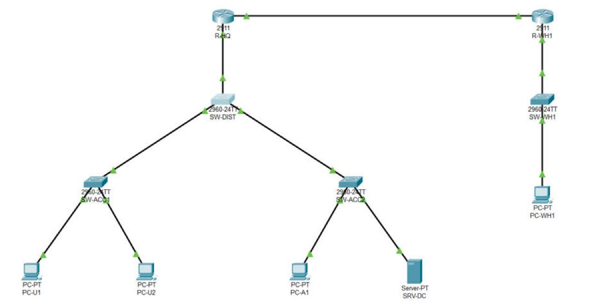

# BlueHarbor Logistics - Infrastructure dossier

## Architecture

### Target deployment model (v1, from Foundations step 5)

| Workload | Model | Reason |
|----------|-------|--------|
| Active Directory | On-premises (private) | Local logins and GPOs at HQ and WH1, available even without Internet |
| Finance application | On-premises (private) | Sensitive data, needs a specific OS version |
| TrackIt website | Public cloud (PaaS, Vercel) | Internet-facing, variable traffic, needs elasticity |
| TrackIt shipment data | Public cloud (DBaaS, Supabase, EU region) | Managed database close to the app, GDPR (EU region) |
| Off-site backups | Public cloud (object storage, EU region) | Off-site copy of the 3-2-1 rule |

The result is a **hybrid** model: on-premises and public cloud connected by encrypted links (VPN or HTTPS APIs) and a common identity.

### HQ and warehouse network (Lab 01, Packet Tracer model)



- **HQ:** R-HQ does inter-VLAN routing (router-on-a-stick on G0/0) and DHCP. SW-DIST is the distribution switch and spanning-tree root; SW-ACC1 (users) and SW-ACC2 (admins, servers) are access switches. Trunks are 802.1Q, native VLAN 99, allowed 10,20,30,99.
- **Warehouse WH1:** R-WH1 with one flat LAN (SW-WH1, PC-WH1), DHCP on R-WH1.
- **WAN:** R-HQ G0/1 to R-WH1 G0/1, /30, OSPF area 0 with passive-interface on every LAN.
- Model file: [lab01/bh-hq.pkt](../lab01/bh-hq.pkt); full per-interface table: [lab01/addressing.md](../lab01/addressing.md).

| Network | Subnet | Gateway | Used for |
|---------|--------|---------|----------|
| VLAN 10 ADMIN | 10.10.10.0/24 | 10.10.10.1 | IT administrators' workstations (DHCP from .21) |
| VLAN 20 SERVERS | 10.10.20.0/24 | 10.10.20.1 | Servers, static (DC01 = 10.10.20.10) |
| VLAN 30 USERS | 10.10.30.0/24 | 10.10.30.1 | Employees' PCs (DHCP from .21) |
| VLAN 99 MGMT | 10.10.99.0/24 | 10.10.99.1 | Switch management (SW-DIST .11, SW-ACC1 .12, SW-ACC2 .13) |
| WAN HQ-WH1 | 10.255.0.0/30 | - | R-HQ .1, R-WH1 .2 |
| WH1 LAN | 10.20.40.0/24 | 10.20.40.1 | Warehouse devices (DHCP from .21) |
| BH-STORAGE | 172.16.30.0/24 | none | VirtualBox internal network for NFS and iSCSI |

### Active Directory (Lab 02)

Domain **blueharbor.internal** (NetBIOS `BLUEHARBOR`), one forest. DC01 (10.10.20.10) is the domain controller and the DNS server.

```
blueharbor.internal
└── BlueHarbor
    ├── Users
    │   ├── Finance      elaurent, mpetit, lmartin
    │   ├── Operations   hbernard, irobert, trichard
    │   └── IT           sdurand, nmoreau, lsimon
    ├── Groups           GG_Finance, GG_Helpdesk, DL_FinanceShare_RW, DL_FinanceShare_R
    ├── Servers
    ├── Computers
    └── Admins
```

- **Access model: AGDLP.** Accounts go into global groups (GG_*), global groups go into domain local groups (DL_*), and only DL groups appear in share and NTFS permissions. Example: GG_Finance → DL_FinanceShare_RW → Modify on `\\DC01\Finance` ([lab02/agdlp.md](../lab02/agdlp.md)).
- **Delegation:** GG_Helpdesk can reset passwords and force a change at next logon on `OU=Users`, without being Domain Admins.
- **Policies:**
  - Default domain policy: 12 characters minimum, complexity on, lockout after 5 attempts for 15 minutes.
  - PSO-Admins applies to Domain Admins: 16 characters, lockout after 3 attempts for 30 minutes, password changed every 90 days.
  - GPO BH-Users-Baseline is linked to `OU=Users` and locks idle sessions after 10 minutes.

| DNS zone | Type | Content |
|----------|------|---------|
| blueharbor.internal | Primary, AD-integrated | DC01 records, `web01` → 10.10.20.20 |
| 20.10.10.in-addr.arpa | Reverse, AD-integrated (domain) | PTR for 10.10.20.0/24 (web01) |
| _msdcs.blueharbor.internal | Primary, AD-integrated (forest) | Domain controller locator records |

Forwarders for names outside the domain: 10.96.23.50, 10.96.23.51 (school network resolvers, because public DNS is blocked there), then 1.1.1.1.

## Operations

### Create a user

Run on DC01 as an administrator. Put the user in the OU of their department, then add them to the global group of that department.

```powershell
New-ADUser -Name "First Last" -GivenName First -Surname Last -SamAccountName flast `
  -UserPrincipalName flast@blueharbor.internal -Department Finance -Title Accountant `
  -Path "OU=Finance,OU=Users,OU=BlueHarbor,DC=blueharbor,DC=internal" `
  -AccountPassword (Read-Host -AsSecureString "Initial password") -ChangePasswordAtLogon $true -Enabled $true
Add-ADGroupMember -Identity GG_Finance -Members flast
```

The initial password must have at least 12 characters, with complexity. Give it to the user through a separate channel, and use a different one for each user. Several users at once: [lab02/02-users.ps1](../lab02/02-users.ps1) with a CSV file.

### Grant access to a share

Never put a user directly into a share or NTFS permission. Change group membership only:

1. The user's global group (for example GG_Finance) is added to the DL group of the share and access level: `DL_<Share>_RW` for modify, `DL_<Share>_R` for read only.
2. For a new share, create the two DL groups first. Then grant them on the share (Change / Read) and in NTFS (Modify / Read & execute), with inheritance disabled and `BUILTIN\Users` removed.
3. Check with Effective Access on the folder (Properties > Security > Advanced). The user must sign out and back in to receive the new group.

Temporary access (for example an auditor): put the account in a global group nested in `DL_<Share>_R` and set an account expiry date ([lab02/agdlp.md](../lab02/agdlp.md)).

### SSH access to the Linux servers (Lab 03)

Linux servers accept **SSH keys only**: no password login, no root login, 3 tries, and only members of the `sudo` group (`/etc/ssh/sshd_config.d/10-hardening.conf` and `20-lynis.conf`). ufw only lets SSH in from 10.10.20.0/24.

1. **Create your key once**, on your own laptop: `ssh-keygen -t ed25519 -C "<initials>@blueharbor"`. Protect it with a passphrase. On Windows, the private key file must be readable by your account only.
2. **Have it installed**: an existing admin appends your `.pub` file to `/home/<user>/.ssh/authorized_keys` (directory 700, file 600, owned by the user), and adds the user to the `sudo` group if they administer the server. Never send the private key.
3. **Connect** with the shortcut in `~/.ssh/config`:

   | Host | Address | Port forward | User |
   |------|---------|--------------|------|
   | web01 | 10.10.20.20 | 127.0.0.1:2220 | opsadmin |
   | web02 | 10.10.20.21 | 127.0.0.1:2221 | opsadmin |
   | stor01 | 10.10.20.30 | 127.0.0.1:2230 | opsadmin |

   `ssh web01`. On the first connection, compare the fingerprint shown with the one on the VM console (`ssh-keygen -lf /etc/ssh/ssh_host_ed25519_key.pub`).
4. **Remove access**: delete the line from `authorized_keys` and remove the user from `sudo`.
5. **Locked out** (after an SSH change): open the VM console in VirtualBox, sign in, run `sshd -t`, then fix or remove the file in `/etc/ssh/sshd_config.d/`.

### Health-check runbook (Lab 03)

`/usr/local/bin/bh-health.sh` runs every 5 minutes through `bh-health.timer` and appends one line to `/var/log/bh-health.log`: load, memory %, disk %, status. It raises `WARN` at **80 % disk** or **90 % memory** and writes it to the journal with the tag `bh-health`. Files: [lab03/bh-health.sh](../lab03/bh-health.sh), [.service](../lab03/bh-health.service), [.timer](../lab03/bh-health.timer).

| Check | Command | Expected |
|-------|---------|----------|
| Timer running | `systemctl list-timers bh-health.timer` | a NEXT time within 5 minutes |
| Recent results | `tail -5 /var/log/bh-health.log` | last line less than 5 minutes old, `status=OK` |
| Warnings | `journalctl -t bh-health --since today` | empty |
| Run now | `sudo systemctl start bh-health.service` | a new line in the log |

When a line says `status=WARN`:

- **Disk:** `df -h /`, then `sudo du -xh / --max-depth=2 | sort -h | tail` to find the big directory. Look for hidden files (`ls -la`). Check that a file is not in use (`fuser`) before deleting it.
- **Memory:** `free -h`, `top` sorted by memory (`M`). There is no swap on WEB01, so act before the kernel kills a process.
- **No new line for more than 10 minutes:** the check itself is broken. Run `systemctl is-enabled bh-health.timer` and `systemctl status bh-health.service`. Re-enable with `sudo systemctl enable --now bh-health.timer`.

When the service is down (Exercise 3.5): `curl -I http://localhost`, then follow the method in this order:

1. service state (`systemctl status`; a *masked* unit is not listed as failed);
2. logs (`journalctl -u <unit>`);
3. resources (`df`, `du`);
4. permissions (`ls -l`);
5. scheduled jobs (`systemctl list-timers`).

The four faults met in the challenge are documented in [lab03/troubleshooting.md](../lab03/troubleshooting.md).

## Risks

First entries, from the directory audit of Lab 02 ([lab02/audit.md](../lab02/audit.md)):

| Risk | Impact | Action | Status |
|------|--------|--------|--------|
| A single, shared, built-in admin account (Administrator) is used for all administration | No trace of who did what; one leaked password gives the whole domain | Named admin accounts in `OU=Admins`; built-in Administrator kept as break-glass in KeePass | Open |
| The Administrator password predates the 12- and 16-character policies; the DC clock was wrong during the install | Weak password on the most powerful account; Kerberos failures if the clock drifts | Change the password now (16+ characters); set a reliable NTP source on DC01 | Open |
| 7 enabled accounts never used, all staff share the same initial password | Anyone who knows it can take over a colleague's account | Unique initial passwords; disable unused accounts after 14 days; monthly audit | Open |
| PSO-Admins was created with reversible encryption on (cmdlet default) | Admin passwords stored in a decryptable form | Turned off; always pass `-ReversibleEncryptionEnabled $false` | Fixed |

From the WEB01 hardening of Lab 03 (Lynis index 63 → 71). These Lynis suggestions were **not applied**, on purpose ([lab03/hardening.md](../lab03/hardening.md)):

| Lynis suggestion | Risk if left | Why not fixed now | Status |
|------------------|--------------|-------------------|--------|
| HTTP-6710: no HTTPS on nginx | Traffic to the status page can be read or altered on the network | Needs a certificate; planned with the reverse proxy / PKI work. The page holds no sensitive data yet | Accepted, planned |
| FILE-6310: /var, /tmp, /home on the root partition | A full /var (logs, temp files) fills the whole system, as in the Lab 03 challenge (88 %) | Needs re-partitioning; the 80 % alert of bh-health.sh covers it meanwhile | Accepted |
| ACCT-9628 auditd, FINT-4350 file integrity, LOGG-2154 remote logging | Changes to system files and permissions go unnoticed; logs can be erased by an intruder | Each needs storage and a review routine; planned with central logging | Planned |
| BOOT-5122: no GRUB password | Anyone with console access can boot in single-user mode | Console access already means access to the VirtualBox host; a GRUB password blocks unattended reboots | Accepted |
| AUTH-9230/9262/9286: local password hashing, quality and ageing | Weak local passwords for sudo and the console | SSH accepts keys only; to be handled with central identity (AD) | Accepted |
| DEB-0880: no fail2ban | Brute-force attempts are not banned | Password login is off and SSH only accepts the lab network | Accepted |
| SSH-7408 `Port`: SSH stays on 22 | Port 22 is scanned first | Moving it only hides it; the firewall and key-only login protect it | Accepted |
| KRNL-6000, NETW-3200, USB-1000: extra sysctl values, unused protocols, USB storage | Small extra attack surface in the kernel | Low risk on a VM without USB; next hardening pass | Planned |
| No swap on WEB01 (Lab 03 USE report) | A memory peak ends in an OOM kill of nginx instead of a slowdown | Add a 1 GB swap file with low swappiness | Open |
| The health check runs on the server it watches (Lab 03 challenge) | If the timer is disabled or the server dies, nobody is warned | Outside HTTP probe and heartbeat on the health log | Open |
